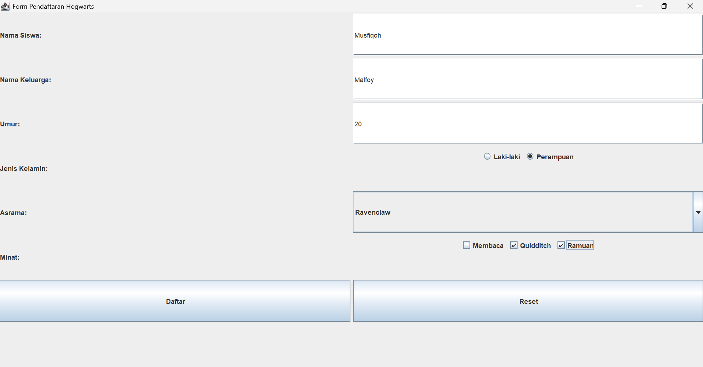
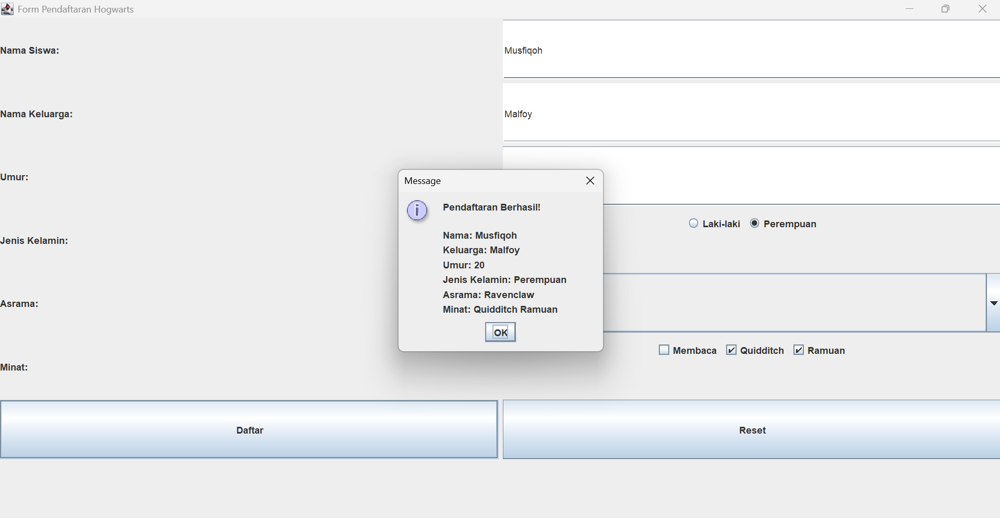

# Form Pendaftaran Siswa Hogwarts

## Deskripsi

Program ini merupakan aplikasi Graphical User Interface (GUI) sederhana menggunakan Java Swing untuk simulasi pendaftaran siswa Hogwarts.

Aplikasi ini memungkinkan pengguna untuk mengisi data pribadi, memilih jenis kelamin, menentukan asrama Hogwarts, memilih minat, serta menampilkan hasil pendaftaran melalui dialog.

## 1. Komponen Utama GUI

Berikut adalah lima komponen utama GUI yang digunakan dalam program ini:

### 1. Top-Level Container Class

**Class: `JFrame`**

JFrame digunakan sebagai jendela utama aplikasi yang menjadi tempat untuk menampilkan seluruh komponen GUI.

Implementasi:
```java
JFrame frame = new JFrame("Form Pendaftaran Hogwarts");
frame.setDefaultCloseOperation(JFrame.EXIT_ON_CLOSE);
frame.setSize(450, 500);
```

### 2. Intermediate Container Class

**Class: `JPanel`**

JPanel digunakan sebagai wadah untuk mengelompokkan komponen-komponen GUI.

Pada program ini terdapat tiga JPanel:
- `panel` untuk menampung seluruh komponen form.
- `panelGender` untuk mengelompokkan pilihan jenis kelamin.
- `panelMinat` untuk mengelompokkan pilihan minat siswa.

Implementasi:
```java
JPanel panel = new JPanel();
JPanel panelGender = new JPanel();
JPanel panelMinat = new JPanel();
```

### 3. Atomic Component Class

tomic Component merupakan komponen GUI yang memiliki fungsi tertentu dan dapat digunakan untuk berinteraksi langsung dengan pengguna.

Komponen yang digunakan dalam program ini antara lain:
- JLabel: Menampilkan keterangan atau label pada setiap bagian formulir.
- JTextField: Menerima input nama siswa, nama keluarga, dan umur.
- JButton: Menjalankan perintah Daftar dan Reset.
- JComboBox: Menyediakan pilihan asrama Hogwarts.
- JRadioButton: Memungkinkan pengguna memilih jenis kelamin.
- JCheckBox: Memungkinkan pengguna memilih minat siswa.
Selain itu, program juga menggunakan JOptionPane untuk menampilkan hasil pendaftaran dalam bentuk dialog setelah pengguna menekan tombol Daftar.

### 4. Layout Classes

Layout Manager digunakan untuk mengatur posisi dan susunan komponen GUI.

Program ini menggunakan dua jenis Layout Manager:

**a. GridLayout**

GridLayout digunakan untuk menyusun komponen utama form dalam bentuk baris dan kolom.

Implementasi:
```java
panel.setLayout(new GridLayout(8, 2, 5, 5));
```

**b. FlowLayout**

FlowLayout digunakan untuk menyusun komponen secara berurutan dari kiri ke kanan.

Layout ini digunakan pada panel jenis kelamin dan panel minat.

Implementasi:
```java
panelGender.setLayout(new FlowLayout());
panelMinat.setLayout(new FlowLayout());
```

### 5. Event Listener

**Interface: `ActionListener`**

ActionListener digunakan untuk menangani interaksi pengguna ketika tombol diklik.

Program ini menggunakan dua event listener:

**a. Tombol Daftar**

Ketika tombol Daftar diklik, program mengambil data yang telah dimasukkan pengguna, kemudian menampilkan hasil pendaftaran menggunakan JOptionPane.

**b. Tombol Reset**

Ketika tombol Reset diklik, seluruh input dikosongkan dan pilihan dikembalikan ke kondisi awal.

Implementasi:
```java
tombolDaftar.addActionListener(new ActionListener() {
    @Override
    public void actionPerformed(ActionEvent e) {
    }
});
```

Method `actionPerformed()` merupakan implementasi dari interface ActionListener dan menggunakan anotasi `@Override`.

## 2. Screenshot Aplikasi


